# Trading Engine Implementation Plan

## Overview

This document provides a comprehensive, test-driven development (TDD) implementation plan for the trading engine, with detailed code architecture, object relationships, and step-by-step development approach. The plan follows the existing codebase patterns and integrates seamlessly with the current event-driven architecture.

## Current Architecture Analysis

### Existing Patterns Identified

1. **Repository Pattern**: PyArrow/Parquet-based storage with `BaseRepository` abstraction
2. **Event-Driven Architecture**: JSONL file-based event bus with `FileEventBus`
3. **Testing Strategy**: Comprehensive pytest setup with 85% coverage requirement
4. **Service Architecture**: FastAPI microservices with clear separation of concerns
5. **IB API Integration**: Existing `IBCore` with connection pooling and wrapper patterns

## Object Relationship Diagram

```mermaid
classDiagram
    %% Core Trading Infrastructure
    class TradingEngine {
        -order_manager: OrderManager
        -position_manager: PositionManager
        -risk_manager: RiskManager
        -strategy_engine: StrategyEngine
        -event_bus: FileEventBus
        +start()
        +stop()
        +get_status()
    }

    %% Order Management Layer
    class OrderManager {
        -ib_client: IBClient
        -order_repository: OrderRepository
        -execution_repository: ExecutionRepository
        -order_tracker: OrderTracker
        +place_order(order: Order) OrderExecution
        +modify_order(order_id: int, modifications: Dict) bool
        +cancel_order(order_id: int) bool
        +get_order_status(order_id: int) OrderStatus
    }

    class Order {
        +order_id: Optional[int]
        +contract: Union[EquityContract, OptionContract]
        +action: OrderAction
        +quantity: int
        +order_type: OrderType
        +limit_price: Optional[Decimal]
        +stop_price: Optional[Decimal]
        +time_in_force: TimeInForce
        +validate() bool
        +to_ib_order() IBOrder
    }

    class OrderTracker {
        -active_orders: Dict[int, OrderStatus]
        -lock: threading.RLock
        +track_order(order: Order) None
        +update_status(order_id: int, status: OrderStatus) None
        +get_active_orders() List[OrderStatus]
    }

    %% Position Management Layer
    class PositionManager {
        -position_repository: PositionRepository
        -pnl_calculator: PnLCalculator
        -market_data_feed: MarketDataFeed
        +get_positions() List[Position]
        +get_portfolio_summary() PortfolioSummary
        +update_position(execution: Execution) None
        +calculate_pnl() PortfolioPnL
    }

    class Position {
        +contract: Contract
        +position_size: int
        +avg_cost: Decimal
        +market_value: Decimal
        +unrealized_pnl: Decimal
        +realized_pnl: Decimal
        +update_market_price(price: Decimal) None
    }

    %% Risk Management Layer
    class RiskManager {
        -risk_config: RiskConfiguration
        -position_monitor: PositionMonitor
        -portfolio_monitor: PortfolioMonitor
        +pre_trade_check(trade: ProposedTrade) RiskCheckResult
        +monitor_positions() List[RiskAlert]
        +enforce_stop_losses() List[OrderExecution]
    }

    class RiskConfiguration {
        +max_position_value: Decimal
        +max_portfolio_delta: Decimal
        +max_daily_loss: Decimal
        +sector_limits: Dict[str, Decimal]
        +validate_config() bool
    }

    %% Strategy Layer
    class StrategyEngine {
        -strategies: Dict[str, BaseStrategy]
        -signal_generator: SignalGenerator
        -backtest_engine: BacktestEngine
        +register_strategy(strategy: BaseStrategy) None
        +generate_signals() List[TradeSignal]
        +execute_strategy(strategy_name: str) List[OrderExecution]
    }

    class BaseStrategy {
        +strategy_name: str
        +parameters: Dict[str, Any]
        +generate_signals(market_data: MarketData) List[TradeSignal]
        +validate_signal(signal: TradeSignal) bool
        +calculate_position_size(signal: TradeSignal) int
    }

    %% Data Layer Integration
    class TradingRepository~T~ {
        <<interface>>
        +save(data: T, **kwargs) None
        +load(filters: List[Filter]) DataFrame
        +get_schema() pa.Schema
    }

    class OrderRepository {
        +save_order(order: Order) None
        +update_order_status(order_id: int, status: OrderStatus) None
        +get_orders(filters: List[Filter]) List[Order]
    }

    class PositionRepository {
        +save_position(position: Position) None
        +get_positions(account: str) List[Position]
        +get_portfolio_history(date_range: Tuple[date, date]) DataFrame
    }

    %% Market Data Integration  
    class MarketDataFeed {
        -ib_client: IBClient
        -subscription_manager: SubscriptionManager
        -data_cache: Dict[str, MarketData]
        +subscribe_real_time(contract: Contract) None
        +get_market_data(contract: Contract) MarketData
        +get_option_chain(symbol: str) OptionChain
    }

    %% Event Integration
    class TradingEventHandler {
        -trading_engine: TradingEngine
        -event_consumers: Dict[str, EventConsumer]
        +handle_earnings_event(event: EarningsEvent) None
        +handle_market_data_event(event: MarketDataEvent) None
        +handle_execution_event(event: ExecutionEvent) None
    }

    %% Relationships
    TradingEngine --> OrderManager
    TradingEngine --> PositionManager
    TradingEngine --> RiskManager
    TradingEngine --> StrategyEngine
    TradingEngine --> TradingEventHandler

    OrderManager --> Order
    OrderManager --> OrderTracker
    OrderManager --> OrderRepository
    OrderManager --> ExecutionRepository

    PositionManager --> Position
    PositionManager --> PositionRepository
    PositionManager --> MarketDataFeed

    RiskManager --> RiskConfiguration
    RiskManager --> PositionManager

    StrategyEngine --> BaseStrategy
    StrategyEngine --> SignalGenerator

    TradingEventHandler --> TradingEngine
    
    OrderRepository --|> TradingRepository
    PositionRepository --|> TradingRepository
```



## Detailed Code Architecture

### Core Data Models (`common/schemas/trading.py`)

```python
from decimal import Decimal
from datetime import datetime, date
from enum import Enum
from typing import Optional, List, Union, Dict, Any
from pydantic import BaseModel, Field, validator
from .base import BaseAPIModel

class OrderAction(str, Enum):
    BUY = "BUY"
    SELL = "SELL"

class OrderType(str, Enum):
    MARKET = "MKT"
    LIMIT = "LMT"
    STOP = "STP"
    STOP_LIMIT = "STP LMT"
    BRACKET = "BRACKET"

class TimeInForce(str, Enum):
    DAY = "DAY"
    GTC = "GTC"  # Good Till Cancelled
    IOC = "IOC"  # Immediate or Cancel
    FOK = "FOK"  # Fill or Kill

class OrderStatus(str, Enum):
    PENDING_SUBMIT = "PendingSubmit"
    SUBMITTED = "Submitted"
    FILLED = "Filled"
    CANCELLED = "Cancelled"
    PENDING_CANCEL = "PendingCancel"
    REJECTED = "Rejected"

class Order(BaseAPIModel):
    order_id: Optional[int] = None
    client_order_id: str = Field(..., description="Client-generated unique ID")
    contract: Union[EquityContract, OptionContract] = Field(..., description="Trading contract")
    action: OrderAction = Field(..., description="Buy or Sell")
    quantity: int = Field(..., gt=0, description="Order quantity")
    order_type: OrderType = Field(..., description="Order type")
    limit_price: Optional[Decimal] = Field(None, gt=0, description="Limit price")
    stop_price: Optional[Decimal] = Field(None, gt=0, description="Stop price")
    time_in_force: TimeInForce = Field(default=TimeInForce.DAY)
    account: Optional[str] = Field(None, description="Trading account")
    parent_order_id: Optional[int] = Field(None, description="Parent order for bracket orders")
    created_at: datetime = Field(default_factory=datetime.utcnow)
    
    @validator('limit_price')
    def validate_limit_price(cls, v, values):
        if values.get('order_type') in [OrderType.LIMIT, OrderType.STOP_LIMIT] and v is None:
            raise ValueError("Limit price required for limit orders")
        return v
    
    @validator('stop_price')
    def validate_stop_price(cls, v, values):
        if values.get('order_type') in [OrderType.STOP, OrderType.STOP_LIMIT] and v is None:
            raise ValueError("Stop price required for stop orders")
        return v

class ExecutionReport(BaseAPIModel):
    execution_id: str = Field(..., description="Unique execution ID")
    order_id: int = Field(..., description="Order ID")
    contract: Union[EquityContract, OptionContract]
    action: OrderAction
    quantity: int = Field(..., gt=0)
    price: Decimal = Field(..., gt=0)
    commission: Optional[Decimal] = Field(None, ge=0)
    timestamp: datetime = Field(default_factory=datetime.utcnow)

class Position(BaseAPIModel):
    contract: Union[EquityContract, OptionContract]
    position_size: int = Field(..., description="Positive=long, negative=short")
    avg_cost: Decimal = Field(..., description="Average cost basis")
    market_price: Decimal = Field(..., gt=0, description="Current market price")
    market_value: Decimal = Field(..., description="Current market value")
    unrealized_pnl: Decimal = Field(..., description="Unrealized P&L")
    realized_pnl: Decimal = Field(default=Decimal("0"), description="Realized P&L")
    last_updated: datetime = Field(default_factory=datetime.utcnow)
    
    @property
    def is_long(self) -> bool:
        return self.position_size > 0
    
    @property
    def is_short(self) -> bool:
        return self.position_size < 0
```

### Repository Layer (`common/repositories/trading/`)

#### Base Trading Repository (`common/repositories/trading/base.py`)

```python
from abc import abstractmethod
from common.repositories.base import BaseRepository
from typing import List, Dict, Any, Optional, TypeVar, Generic
import pandas as pd
import pyarrow as pa

T = TypeVar('T')

class BaseTradingRepository(BaseRepository, Generic[T]):
    """Base class for trading-specific repositories."""
    
    def __init__(self, data_dir: str, table_name: str):
        super().__init__(data_dir)
        self.table_name = table_name
        self.table_path = self.data_dir / "trading" / table_name
    
    @abstractmethod
    def get_schema(self) -> pa.Schema:
        """Define the PyArrow schema for the trading data."""
        pass
    
    @abstractmethod
    def normalize_data(self, data: T) -> Dict[str, Any]:
        """Convert domain object to dictionary for storage."""
        pass
    
    def save(self, data: T, **kwargs) -> None:
        """Save trading data with proper partitioning."""
        normalized = self.normalize_data(data)
        df = pd.DataFrame([normalized])
        self._save_parquet(df, self.table_path, **kwargs)
    
    def save_batch(self, data_list: List[T], **kwargs) -> None:
        """Save multiple records efficiently."""
        normalized_list = [self.normalize_data(item) for item in data_list]
        df = pd.DataFrame(normalized_list)
        self._save_parquet(df, self.table_path, **kwargs)
```

#### Order Repository (`common/repositories/trading/orders.py`)

```python
from .base import BaseTradingRepository
from common.schemas.trading import Order, OrderStatus, ExecutionReport
from typing import List, Dict, Any, Optional
from datetime import datetime, date
import pandas as pd
import pyarrow as pa

class OrderRepository(BaseTradingRepository[Order]):
    """Repository for order data management."""
    
    def get_schema(self) -> pa.Schema:
        return pa.schema([
            ("order_id", pa.int64()),
            ("client_order_id", pa.string()),
            ("symbol", pa.string()),
            ("sec_type", pa.string()),
            ("action", pa.string()),
            ("quantity", pa.int32()),
            ("order_type", pa.string()),
            ("limit_price", pa.float64()),
            ("stop_price", pa.float64()),
            ("time_in_force", pa.string()),
            ("account", pa.string()),
            ("parent_order_id", pa.int64()),
            ("status", pa.string()),
            ("created_at", pa.timestamp('us')),
            ("updated_at", pa.timestamp('us')),
            ("date", pa.date32()),  # Partition column
        ])
    
    def normalize_data(self, order: Order) -> Dict[str, Any]:
        return {
            "order_id": order.order_id,
            "client_order_id": order.client_order_id,
            "symbol": order.contract.symbol,
            "sec_type": order.contract.sec_type.value,
            "action": order.action.value,
            "quantity": order.quantity,
            "order_type": order.order_type.value,
            "limit_price": float(order.limit_price) if order.limit_price else None,
            "stop_price": float(order.stop_price) if order.stop_price else None,
            "time_in_force": order.time_in_force.value,
            "account": order.account,
            "parent_order_id": order.parent_order_id,
            "status": OrderStatus.PENDING_SUBMIT.value,  # Default status
            "created_at": order.created_at,
            "updated_at": order.created_at,
            "date": order.created_at.date(),
        }
    
    def update_order_status(self, order_id: int, status: OrderStatus, 
                           filled_qty: int = 0, avg_fill_price: Optional[float] = None) -> None:
        """Update order status in the repository."""
        # Implementation would update the parquet files
        # This is a simplified version - production would need more sophisticated updates
        filters = [("order_id", "==", order_id)]
        df = self.load_dataframe(filters=filters, limit=1)
        
        if not df.empty:
            # Update status and other fields
            df.loc[df['order_id'] == order_id, 'status'] = status.value
            df.loc[df['order_id'] == order_id, 'updated_at'] = datetime.utcnow()
            if filled_qty > 0:
                df.loc[df['order_id'] == order_id, 'filled_qty'] = filled_qty
            if avg_fill_price:
                df.loc[df['order_id'] == order_id, 'avg_fill_price'] = avg_fill_price
            
            # Save back to parquet (this would need proper implementation)
            self._update_parquet(df, filters)
    
    def get_orders(self, account: Optional[str] = None, 
                  status: Optional[OrderStatus] = None,
                  date_range: Optional[tuple] = None) -> List[Order]:
        """Retrieve orders with optional filters."""
        filters = []
        if account:
            filters.append(("account", "==", account))
        if status:
            filters.append(("status", "==", status.value))
        if date_range:
            start_date, end_date = date_range
            filters.append(("date", "between", (start_date, end_date)))
        
        df = self.load_dataframe(filters=filters)
        return [self._df_row_to_order(row) for _, row in df.iterrows()]
    
    def _df_row_to_order(self, row: pd.Series) -> Order:
        """Convert DataFrame row back to Order object."""
        # This would need proper contract reconstruction logic
        # Simplified for illustration
        contract = EquityContract(
            symbol=row['symbol'],
            sec_type=row['sec_type']
        )
        
        return Order(
            order_id=row['order_id'],
            client_order_id=row['client_order_id'],
            contract=contract,
            action=OrderAction(row['action']),
            quantity=row['quantity'],
            order_type=OrderType(row['order_type']),
            limit_price=Decimal(str(row['limit_price'])) if pd.notna(row['limit_price']) else None,
            stop_price=Decimal(str(row['stop_price'])) if pd.notna(row['stop_price']) else None,
            time_in_force=TimeInForce(row['time_in_force']),
            account=row['account'],
            parent_order_id=row['parent_order_id'] if pd.notna(row['parent_order_id']) else None,
            created_at=row['created_at']
        )

class ExecutionRepository(BaseTradingRepository[ExecutionReport]):
    """Repository for execution data management."""
    
    def get_schema(self) -> pa.Schema:
        return pa.schema([
            ("execution_id", pa.string()),
            ("order_id", pa.int64()),
            ("symbol", pa.string()),
            ("sec_type", pa.string()),
            ("action", pa.string()),
            ("quantity", pa.int32()),
            ("price", pa.float64()),
            ("commission", pa.float64()),
            ("timestamp", pa.timestamp('us')),
            ("date", pa.date32()),  # Partition column
        ])
    
    def normalize_data(self, execution: ExecutionReport) -> Dict[str, Any]:
        return {
            "execution_id": execution.execution_id,
            "order_id": execution.order_id,
            "symbol": execution.contract.symbol,
            "sec_type": execution.contract.sec_type.value,
            "action": execution.action.value,
            "quantity": execution.quantity,
            "price": float(execution.price),
            "commission": float(execution.commission) if execution.commission else 0.0,
            "timestamp": execution.timestamp,
            "date": execution.timestamp.date(),
        }
```

### Order Management Layer (`common/trading/order_manager.py`)

```python
from typing import Dict, List, Optional, Callable
from decimal import Decimal
from threading import RLock, Event
from datetime import datetime
import logging
import uuid

from common.schemas.trading import Order, OrderStatus, ExecutionReport, OrderAction
from common.repositories.trading.orders import OrderRepository, ExecutionRepository
from common.api.ib_core import IBRuntime, IBFuture
from common.utils.events.bus import FileEventBus
from ibapi.order import Order as IBOrder
from ibapi.contract import Contract as IBContract

logger = logging.getLogger(__name__)

class OrderTracker:
    """Thread-safe order status tracking."""
    
    def __init__(self):
        self._orders: Dict[int, OrderStatus] = {}
        self._callbacks: Dict[int, List[Callable[[OrderStatus], None]]] = {}
        self._lock = RLock()
    
    def track_order(self, order_id: int, callback: Optional[Callable[[OrderStatus], None]] = None) -> None:
        with self._lock:
            self._orders[order_id] = OrderStatus.PENDING_SUBMIT
            if callback:
                self._callbacks.setdefault(order_id, []).append(callback)
    
    def update_status(self, order_id: int, status: OrderStatus) -> None:
        with self._lock:
            if order_id in self._orders:
                old_status = self._orders[order_id]
                self._orders[order_id] = status
                
                # Trigger callbacks
                for callback in self._callbacks.get(order_id, []):
                    try:
                        callback(status)
                    except Exception as e:
                        logger.error(f"Order callback error for {order_id}: {e}")
                
                # Remove completed orders from tracking
                if status in [OrderStatus.FILLED, OrderStatus.CANCELLED, OrderStatus.REJECTED]:
                    self._callbacks.pop(order_id, None)
                    # Keep status for reference but don't track callbacks
    
    def get_status(self, order_id: int) -> Optional[OrderStatus]:
        with self._lock:
            return self._orders.get(order_id)
    
    def get_active_orders(self) -> Dict[int, OrderStatus]:
        with self._lock:
            return {
                oid: status for oid, status in self._orders.items()
                if status not in [OrderStatus.FILLED, OrderStatus.CANCELLED, OrderStatus.REJECTED]
            }

class OrderManager:
    """Comprehensive order management with IB API integration."""
    
    def __init__(self, 
                 ib_runtime: IBRuntime,
                 order_repository: OrderRepository,
                 execution_repository: ExecutionRepository,
                 event_bus: FileEventBus):
        self.ib_runtime = ib_runtime
        self.order_repo = order_repository
        self.execution_repo = execution_repository
        self.event_bus = event_bus
        self.order_tracker = OrderTracker()
        self._order_id_map: Dict[str, int] = {}  # client_order_id -> order_id
        
        # Setup IB API callbacks
        self._setup_ib_callbacks()
    
    def _setup_ib_callbacks(self) -> None:
        """Setup callbacks for IB API order events."""
        # This would integrate with the existing IBWrapperBridge
        # Implementation depends on how callbacks are handled in current system
        pass
    
    def place_order(self, order: Order) -> OrderExecution:
        """Place an order with comprehensive error handling and tracking."""
        
        # Generate client order ID if not provided
        if not order.client_order_id:
            order.client_order_id = f"order_{uuid.uuid4().hex[:8]}"
        
        # Pre-trade validation
        validation_result = self._validate_order(order)
        if not validation_result.is_valid:
            raise ValueError(f"Order validation failed: {validation_result.reason}")
        
        # Convert to IB order format
        ib_contract = self._convert_to_ib_contract(order.contract)
        ib_order = self._convert_to_ib_order(order)
        
        # Get next order ID from IB
        order_id = self.ib_runtime.next_order_id()
        order.order_id = order_id
        
        # Save order to repository
        self.order_repo.save(order)
        
        # Track order
        order_completion = Event()
        final_status = [None]  # Mutable container for closure
        
        def order_callback(status: OrderStatus):
            if status in [OrderStatus.FILLED, OrderStatus.CANCELLED, OrderStatus.REJECTED]:
                final_status[0] = status
                order_completion.set()
        
        self.order_tracker.track_order(order_id, order_callback)
        
        try:
            # Submit to IB API
            self.ib_runtime.client.placeOrder(order_id, ib_contract, ib_order)
            
            # Publish order placed event
            self.event_bus.publish(
                "order_placed",
                "trading",
                {
                    "order_id": order_id,
                    "client_order_id": order.client_order_id,
                    "symbol": order.contract.symbol,
                    "action": order.action.value,
                    "quantity": order.quantity
                }
            )
            
            return OrderExecution(
                order_id=order_id,
                client_order_id=order.client_order_id,
                status=OrderStatus.SUBMITTED,
                message="Order submitted successfully"
            )
            
        except Exception as e:
            logger.error(f"Failed to place order {order.client_order_id}: {e}")
            self.order_tracker.update_status(order_id, OrderStatus.REJECTED)
            self.order_repo.update_order_status(order_id, OrderStatus.REJECTED)
            raise
    
    def modify_order(self, order_id: int, modifications: Dict[str, Any]) -> bool:
        """Modify an existing order."""
        current_status = self.order_tracker.get_status(order_id)
        if current_status not in [OrderStatus.SUBMITTED, OrderStatus.PENDING_SUBMIT]:
            raise ValueError(f"Cannot modify order {order_id} with status {current_status}")
        
        # Load current order
        orders = self.order_repo.get_orders()
        current_order = next((o for o in orders if o.order_id == order_id), None)
        if not current_order:
            raise ValueError(f"Order {order_id} not found")
        
        # Apply modifications
        for field, value in modifications.items():
            if hasattr(current_order, field):
                setattr(current_order, field, value)
        
        # Convert and resubmit
        ib_contract = self._convert_to_ib_contract(current_order.contract)
        ib_order = self._convert_to_ib_order(current_order)
        
        try:
            self.ib_runtime.client.placeOrder(order_id, ib_contract, ib_order)
            return True
        except Exception as e:
            logger.error(f"Failed to modify order {order_id}: {e}")
            return False
    
    def cancel_order(self, order_id: int) -> bool:
        """Cancel an active order."""
        try:
            self.ib_runtime.client.cancelOrder(order_id)
            self.order_tracker.update_status(order_id, OrderStatus.PENDING_CANCEL)
            return True
        except Exception as e:
            logger.error(f"Failed to cancel order {order_id}: {e}")
            return False
    
    def get_order_status(self, order_id: int) -> Optional[OrderStatus]:
        """Get current status of an order."""
        return self.order_tracker.get_status(order_id)
    
    def get_active_orders(self) -> List[Dict[str, Any]]:
        """Get all active orders."""
        active = self.order_tracker.get_active_orders()
        return [
            {"order_id": oid, "status": status.value}
            for oid, status in active.items()
        ]
    
    def _validate_order(self, order: Order) -> OrderValidationResult:
        """Comprehensive order validation."""
        # Basic validation
        if order.quantity <= 0:
            return OrderValidationResult(False, "Quantity must be positive")
        
        if order.order_type == OrderType.LIMIT and not order.limit_price:
            return OrderValidationResult(False, "Limit price required for limit orders")
        
        if order.order_type in [OrderType.STOP, OrderType.STOP_LIMIT] and not order.stop_price:
            return OrderValidationResult(False, "Stop price required for stop orders")
        
        # Add more sophisticated validation (position limits, etc.)
        return OrderValidationResult(True, "Order valid")
    
    def _convert_to_ib_contract(self, contract) -> IBContract:
        """Convert domain contract to IB API contract."""
        ib_contract = IBContract()
        ib_contract.symbol = contract.symbol
        ib_contract.secType = contract.sec_type.value
        ib_contract.exchange = contract.exchange
        ib_contract.currency = contract.currency
        
        # Handle option-specific fields
        if hasattr(contract, 'expiry'):
            ib_contract.lastTradeDateOrContractMonth = contract.expiry.strftime("%Y%m%d")
            ib_contract.strike = float(contract.strike)
            ib_contract.right = contract.right.value
            ib_contract.multiplier = contract.multiplier or "100"
        
        return ib_contract
    
    def _convert_to_ib_order(self, order: Order) -> IBOrder:
        """Convert domain order to IB API order."""
        ib_order = IBOrder()
        ib_order.action = order.action.value
        ib_order.totalQuantity = order.quantity
        ib_order.orderType = order.order_type.value
        ib_order.tif = order.time_in_force.value
        
        if order.limit_price:
            ib_order.lmtPrice = float(order.limit_price)
        if order.stop_price:
            ib_order.auxPrice = float(order.stop_price)
        if order.account:
            ib_order.account = order.account
        
        return ib_order

@dataclass
class OrderValidationResult:
    is_valid: bool
    reason: str = ""

@dataclass 
class OrderExecution:
    order_id: int
    client_order_id: str
    status: OrderStatus
    message: str
    timestamp: datetime = field(default_factory=datetime.utcnow)
```

## Test-Driven Development Implementation Plan

### Phase 1: Foundation Layer (Weeks 1-3)

#### Week 1: Core Data Models and Schemas

**Test Files to Create:**
- `tests/unit/schemas/test_trading_schemas.py`
- `tests/unit/repositories/trading/test_order_repository.py`

**TDD Cycle:**

##### Day 1-2: Trading Schemas
```python
# tests/unit/schemas/test_trading_schemas.py
import pytest
from decimal import Decimal
from datetime import datetime
from common.schemas.trading import Order, OrderAction, OrderType, EquityContract
from pydantic import ValidationError

class TestOrder:
    """Test Order schema validation and behavior."""
    
    def test_order_creation_with_valid_data(self):
        """Test creating order with all required fields."""
        contract = EquityContract(symbol="AAPL", sec_type="STK")
        order = Order(
            client_order_id="test-123",
            contract=contract,
            action=OrderAction.BUY,
            quantity=100,
            order_type=OrderType.MARKET
        )
        
        assert order.client_order_id == "test-123"
        assert order.contract.symbol == "AAPL"
        assert order.action == OrderAction.BUY
        assert order.quantity == 100
        assert order.order_type == OrderType.MARKET
    
    def test_order_validation_fails_with_zero_quantity(self):
        """Test order validation fails with zero quantity."""
        contract = EquityContract(symbol="AAPL", sec_type="STK")
        
        with pytest.raises(ValidationError) as exc_info:
            Order(
                client_order_id="test-123",
                contract=contract,
                action=OrderAction.BUY,
                quantity=0,  # Invalid
                order_type=OrderType.MARKET
            )
        
        assert "quantity" in str(exc_info.value)
    
    def test_limit_order_requires_limit_price(self):
        """Test limit order validation requires limit price."""
        contract = EquityContract(symbol="AAPL", sec_type="STK")
        
        with pytest.raises(ValidationError) as exc_info:
            Order(
                client_order_id="test-123",
                contract=contract,
                action=OrderAction.BUY,
                quantity=100,
                order_type=OrderType.LIMIT,
                # limit_price missing
            )
        
        assert "limit_price" in str(exc_info.value)
    
    def test_order_to_ib_order_conversion(self):
        """Test conversion to IB API order format."""
        contract = EquityContract(symbol="AAPL", sec_type="STK")
        order = Order(
            client_order_id="test-123",
            contract=contract,
            action=OrderAction.BUY,
            quantity=100,
            order_type=OrderType.LIMIT,
            limit_price=Decimal("150.00")
        )
        
        ib_order_dict = order.to_ib_order()
        
        assert ib_order_dict["action"] == "BUY"
        assert ib_order_dict["totalQuantity"] == 100
        assert ib_order_dict["orderType"] == "LMT"
        assert ib_order_dict["lmtPrice"] == 150.00

# Run: pytest tests/unit/schemas/test_trading_schemas.py -v
# EXPECTED: ALL TESTS FAIL (Red phase)
```

**Implementation (Green phase):**
```python
# common/schemas/trading.py - Implement the Order class to pass tests
# ... (Previous Order implementation from architecture section)
```

**Refactor phase:** Clean up implementation, add edge cases.

##### Day 3-4: Order Repository Tests
```python
# tests/unit/repositories/trading/test_order_repository.py
import pytest
from unittest.mock import Mock, patch
from decimal import Decimal
from datetime import datetime, date
from common.repositories.trading.orders import OrderRepository
from common.schemas.trading import Order, OrderAction, OrderType, OrderStatus, EquityContract

@pytest.fixture
def temp_data_dir(tmp_path):
    """Temporary directory for test data."""
    return str(tmp_path)

@pytest.fixture
def order_repo(temp_data_dir):
    """Order repository instance for testing."""
    return OrderRepository(temp_data_dir)

@pytest.fixture
def sample_order():
    """Sample order for testing."""
    contract = EquityContract(symbol="AAPL", sec_type="STK")
    return Order(
        client_order_id="test-order-123",
        contract=contract,
        action=OrderAction.BUY,
        quantity=100,
        order_type=OrderType.MARKET
    )

class TestOrderRepository:
    """Test OrderRepository functionality."""
    
    def test_repository_initialization(self, order_repo):
        """Test repository initializes with correct paths."""
        assert order_repo.table_name == "orders"
        assert "trading/orders" in str(order_repo.table_path)
    
    def test_get_schema_returns_valid_arrow_schema(self, order_repo):
        """Test schema definition is valid."""
        schema = order_repo.get_schema()
        
        required_fields = [
            "order_id", "client_order_id", "symbol", "sec_type", 
            "action", "quantity", "order_type", "created_at", "date"
        ]
        
        schema_field_names = [field.name for field in schema]
        for field in required_fields:
            assert field in schema_field_names
    
    def test_normalize_data_converts_order_to_dict(self, order_repo, sample_order):
        """Test order normalization for storage."""
        normalized = order_repo.normalize_data(sample_order)
        
        assert normalized["client_order_id"] == "test-order-123"
        assert normalized["symbol"] == "AAPL"
        assert normalized["sec_type"] == "STK"
        assert normalized["action"] == "BUY"
        assert normalized["quantity"] == 100
        assert normalized["order_type"] == "MKT"
        assert isinstance(normalized["date"], date)
    
    @patch('common.repositories.trading.orders.OrderRepository._save_parquet')
    def test_save_order_calls_parquet_save(self, mock_save, order_repo, sample_order):
        """Test save method calls underlying parquet save."""
        order_repo.save(sample_order)
        
        mock_save.assert_called_once()
        call_args = mock_save.call_args
        df_arg = call_args[0][0]  # First positional argument (DataFrame)
        
        assert len(df_arg) == 1  # One row
        assert df_arg.iloc[0]["client_order_id"] == "test-order-123"
    
    @patch('common.repositories.trading.orders.OrderRepository.load_dataframe')
    def test_get_orders_with_filters(self, mock_load, order_repo):
        """Test retrieving orders with filters."""
        # Mock DataFrame response
        mock_df = Mock()
        mock_df.empty = False
        mock_df.iterrows.return_value = []  # Empty for now
        mock_load.return_value = mock_df
        
        order_repo.get_orders(account="DU123456", status=OrderStatus.FILLED)
        
        # Verify filters were applied
        mock_load.assert_called_once()
        filters = mock_load.call_args[1]['filters']
        
        filter_dict = {f[0]: (f[1], f[2]) for f in filters}
        assert filter_dict["account"] == ("==", "DU123456")
        assert filter_dict["status"] == ("==", "Filled")

# Run: pytest tests/unit/repositories/trading/test_order_repository.py -v
# EXPECTED: TESTS FAIL (Red phase)
```

#### Week 2: Order Repository Implementation

**Implementation (Green phase):**
```python
# common/repositories/trading/__init__.py
# common/repositories/trading/base.py
# common/repositories/trading/orders.py
# ... (Implementation from architecture section)
```

**Additional Tests:**
```python
# tests/unit/repositories/trading/test_order_repository.py (continued)

class TestOrderRepositoryIntegration:
    """Integration tests for OrderRepository with actual file operations."""
    
    def test_save_and_retrieve_order_roundtrip(self, order_repo, sample_order):
        """Test complete save and retrieve cycle."""
        # Save order
        sample_order.order_id = 12345
        order_repo.save(sample_order)
        
        # Retrieve orders
        retrieved_orders = order_repo.get_orders()
        
        assert len(retrieved_orders) == 1
        retrieved = retrieved_orders[0]
        
        assert retrieved.order_id == 12345
        assert retrieved.client_order_id == sample_order.client_order_id
        assert retrieved.contract.symbol == sample_order.contract.symbol
    
    def test_update_order_status_modifies_existing_record(self, order_repo, sample_order):
        """Test order status update functionality."""
        sample_order.order_id = 12345
        order_repo.save(sample_order)
        
        # Update status
        order_repo.update_order_status(12345, OrderStatus.FILLED, filled_qty=100, avg_fill_price=150.50)
        
        # Verify update
        orders = order_repo.get_orders()
        updated_order = next(o for o in orders if o.order_id == 12345)
        
        # Note: This test will drive the implementation of status updates
        assert updated_order.status == OrderStatus.FILLED
```

#### Week 3: Order Manager Core

**Test First (Red phase):**
```python
# tests/unit/trading/test_order_manager.py
import pytest
from unittest.mock import Mock, AsyncMock, patch, MagicMock
from datetime import datetime
from decimal import Decimal

from common.trading.order_manager import OrderManager, OrderTracker
from common.schemas.trading import Order, OrderStatus, OrderAction, OrderType, EquityContract
from common.repositories.trading.orders import OrderRepository
from common.utils.events.bus import FileEventBus

@pytest.fixture
def mock_ib_runtime():
    """Mock IB runtime for testing."""
    mock_runtime = Mock()
    mock_runtime.next_order_id.return_value = 12345
    mock_runtime.client = Mock()
    return mock_runtime

@pytest.fixture
def mock_order_repo():
    """Mock order repository."""
    return Mock(spec=OrderRepository)

@pytest.fixture
def mock_event_bus():
    """Mock event bus."""
    return Mock(spec=FileEventBus)

@pytest.fixture
def order_manager(mock_ib_runtime, mock_order_repo, mock_event_bus):
    """Order manager instance for testing."""
    return OrderManager(
        ib_runtime=mock_ib_runtime,
        order_repository=mock_order_repo,
        execution_repository=Mock(),
        event_bus=mock_event_bus
    )

@pytest.fixture
def sample_market_order():
    """Sample market order."""
    contract = EquityContract(symbol="AAPL", sec_type="STK")
    return Order(
        client_order_id="test-market-123",
        contract=contract,
        action=OrderAction.BUY,
        quantity=100,
        order_type=OrderType.MARKET
    )

class TestOrderTracker:
    """Test OrderTracker functionality."""
    
    def test_track_order_stores_initial_status(self):
        """Test tracking new order with initial status."""
        tracker = OrderTracker()
        
        tracker.track_order(12345)
        
        status = tracker.get_status(12345)
        assert status == OrderStatus.PENDING_SUBMIT
    
    def test_update_status_changes_tracked_order(self):
        """Test updating order status."""
        tracker = OrderTracker()
        tracker.track_order(12345)
        
        tracker.update_status(12345, OrderStatus.SUBMITTED)
        
        status = tracker.get_status(12345)
        assert status == OrderStatus.SUBMITTED
    
    def test_callback_triggered_on_status_change(self):
        """Test callback is called when status changes."""
        tracker = OrderTracker()
        callback_mock = Mock()
        
        tracker.track_order(12345, callback_mock)
        tracker.update_status(12345, OrderStatus.FILLED)
        
        callback_mock.assert_called_once_with(OrderStatus.FILLED)
    
    def test_get_active_orders_excludes_completed(self):
        """Test active orders excludes filled/cancelled orders."""
        tracker = OrderTracker()
        
        tracker.track_order(1, None)  # PENDING_SUBMIT
        tracker.track_order(2, None)  # PENDING_SUBMIT
        tracker.update_status(1, OrderStatus.SUBMITTED)
        tracker.update_status(2, OrderStatus.FILLED)
        
        active = tracker.get_active_orders()
        
        assert 1 in active
        assert 2 not in active  # FILLED should not be active
        assert active[1] == OrderStatus.SUBMITTED

class TestOrderManager:
    """Test OrderManager core functionality."""
    
    def test_initialization_sets_up_dependencies(self, order_manager):
        """Test order manager initializes with all dependencies."""
        assert order_manager.ib_runtime is not None
        assert order_manager.order_repo is not None
        assert order_manager.event_bus is not None
        assert isinstance(order_manager.order_tracker, OrderTracker)
    
    def test_place_order_validates_before_submission(self, order_manager, sample_market_order):
        """Test order validation before placing."""
        # This will drive the implementation of _validate_order
        invalid_order = sample_market_order
        invalid_order.quantity = 0  # Invalid quantity
        
        with pytest.raises(ValueError) as exc_info:
            order_manager.place_order(invalid_order)
        
        assert "validation failed" in str(exc_info.value).lower()
    
    def test_place_order_assigns_order_id_and_saves(self, order_manager, sample_market_order):
        """Test successful order placement workflow."""
        result = order_manager.place_order(sample_market_order)
        
        # Verify order ID assigned
        assert sample_market_order.order_id == 12345  # From mock
        
        # Verify saved to repository
        order_manager.order_repo.save.assert_called_once_with(sample_market_order)
        
        # Verify IB API called
        order_manager.ib_runtime.client.placeOrder.assert_called_once()
        
        # Verify event published
        order_manager.event_bus.publish.assert_called_once()
        
        # Verify return value
        assert result.order_id == 12345
        assert result.status == OrderStatus.SUBMITTED
    
    def test_place_order_handles_ib_api_failure(self, order_manager, sample_market_order):
        """Test error handling when IB API fails."""
        # Make IB API raise exception
        order_manager.ib_runtime.client.placeOrder.side_effect = Exception("IB connection failed")
        
        with pytest.raises(Exception) as exc_info:
            order_manager.place_order(sample_market_order)
        
        # Verify order status set to rejected
        status = order_manager.order_tracker.get_status(12345)
        assert status == OrderStatus.REJECTED
    
    def test_cancel_order_calls_ib_api(self, order_manager):
        """Test order cancellation."""
        order_id = 12345
        
        result = order_manager.cancel_order(order_id)
        
        order_manager.ib_runtime.client.cancelOrder.assert_called_once_with(order_id)
        assert result is True
        
        # Verify status updated
        status = order_manager.order_tracker.get_status(order_id)
        assert status == OrderStatus.PENDING_CANCEL

# Run: pytest tests/unit/trading/test_order_manager.py -v
# EXPECTED: ALL TESTS FAIL (Red phase - classes don't exist yet)
```

**Implementation (Green phase):**
```python
# common/trading/__init__.py
# common/trading/order_manager.py
# ... (Implementation from architecture section)
```

### Phase 2: Position Management & Risk (Weeks 4-6)

#### Week 4: Position Management

**Tests First:**
```python
# tests/unit/trading/test_position_manager.py
import pytest
from decimal import Decimal
from datetime import datetime
from unittest.mock import Mock, patch

from common.trading.position_manager import PositionManager, PnLCalculator
from common.schemas.trading import Position, ExecutionReport, EquityContract
from common.repositories.trading.positions import PositionRepository

@pytest.fixture
def sample_position():
    """Sample position for testing."""
    contract = EquityContract(symbol="AAPL", sec_type="STK")
    return Position(
        contract=contract,
        position_size=100,
        avg_cost=Decimal("150.00"),
        market_price=Decimal("155.00"),
        market_value=Decimal("15500.00"),
        unrealized_pnl=Decimal("500.00")
    )

class TestPnLCalculator:
    """Test P&L calculation logic."""
    
    def test_calculate_unrealized_pnl_long_position(self):
        """Test unrealized P&L for long position."""
        calculator = PnLCalculator()
        
        pnl = calculator.calculate_unrealized_pnl(
            position_size=100,
            avg_cost=Decimal("150.00"),
            current_price=Decimal("155.00")
        )
        
        assert pnl == Decimal("500.00")  # (155 - 150) * 100
    
    def test_calculate_unrealized_pnl_short_position(self):
        """Test unrealized P&L for short position."""
        calculator = PnLCalculator()
        
        pnl = calculator.calculate_unrealized_pnl(
            position_size=-100,
            avg_cost=Decimal("150.00"),
            current_price=Decimal("145.00")
        )
        
        assert pnl == Decimal("500.00")  # (150 - 145) * 100 for short

class TestPositionManager:
    """Test PositionManager functionality."""
    
    def test_update_position_from_execution_new_position(self, sample_execution):
        """Test creating new position from execution."""
        # This test will drive the implementation
        pass
    
    def test_update_position_from_execution_existing_position(self):
        """Test updating existing position from execution."""
        # This test will drive the implementation
        pass
```

#### Week 5: Risk Management

**Tests First:**
```python
# tests/unit/trading/test_risk_manager.py
import pytest
from decimal import Decimal
from unittest.mock import Mock

from common.trading.risk_manager import RiskManager, RiskConfiguration
from common.schemas.trading import ProposedTrade, RiskCheckResult

@pytest.fixture
def risk_config():
    """Sample risk configuration."""
    return RiskConfiguration(
        max_position_value=Decimal("50000"),
        max_portfolio_delta=Decimal("1000"),
        max_daily_loss=Decimal("10000"),
        sector_limits={"TECH": Decimal("0.3")}
    )

class TestRiskManager:
    """Test risk management functionality."""
    
    def test_pre_trade_check_passes_valid_trade(self, risk_config):
        """Test pre-trade check allows valid trade."""
        risk_manager = RiskManager(risk_config)
        
        proposed_trade = ProposedTrade(
            symbol="AAPL",
            action="BUY",
            quantity=100,
            estimated_value=Decimal("15000")
        )
        
        result = risk_manager.pre_trade_check(proposed_trade)
        
        assert result.is_approved is True
        assert result.reason == ""
    
    def test_pre_trade_check_rejects_oversized_position(self, risk_config):
        """Test pre-trade check rejects position exceeding limits."""
        risk_manager = RiskManager(risk_config)
        
        proposed_trade = ProposedTrade(
            symbol="AAPL",
            action="BUY",
            quantity=1000,
            estimated_value=Decimal("100000")  # Exceeds max_position_value
        )
        
        result = risk_manager.pre_trade_check(proposed_trade)
        
        assert result.is_approved is False
        assert "position limit" in result.reason.lower()
```

#### Week 6: Market Data Integration

**Tests First:**
```python
# tests/unit/trading/test_market_data.py
import pytest
from unittest.mock import Mock, AsyncMock
from decimal import Decimal

from common.trading.market_data import MarketDataFeed, MarketData
from common.schemas.trading import EquityContract

class TestMarketDataFeed:
    """Test market data feed functionality."""
    
    @pytest.mark.asyncio
    async def test_subscribe_real_time_data(self):
        """Test real-time data subscription."""
        feed = MarketDataFeed(Mock())
        contract = EquityContract(symbol="AAPL", sec_type="STK")
        
        await feed.subscribe_real_time(contract)
        
        # Verify subscription was set up
        assert contract.symbol in feed._subscriptions
    
    def test_get_market_data_returns_cached_data(self):
        """Test cached market data retrieval."""
        feed = MarketDataFeed(Mock())
        contract = EquityContract(symbol="AAPL", sec_type="STK")
        
        # Cache some data
        test_data = MarketData(
            symbol="AAPL",
            bid=Decimal("150.00"),
            ask=Decimal("150.05"),
            last=Decimal("150.02")
        )
        feed._data_cache["AAPL"] = test_data
        
        result = feed.get_market_data(contract)
        
        assert result.symbol == "AAPL"
        assert result.last == Decimal("150.02")
```

### Phase 3: Strategy Engine (Weeks 7-10)

#### Week 7: Strategy Framework

**Tests First:**
```python
# tests/unit/trading/test_strategy_engine.py
import pytest
from unittest.mock import Mock
from datetime import datetime, date

from common.trading.strategy_engine import StrategyEngine, BaseStrategy
from common.schemas.trading import TradeSignal, MarketData

class MockEarningsStrategy(BaseStrategy):
    """Mock strategy for testing."""
    
    def __init__(self):
        super().__init__("earnings_straddle", {"days_to_earnings": 7})
    
    def generate_signals(self, market_data: MarketData) -> List[TradeSignal]:
        return [
            TradeSignal(
                signal_id="test-signal-1",
                strategy_name=self.strategy_name,
                symbol=market_data.symbol,
                signal_type="ENTRY",
                confidence=0.8,
                target_positions=[],
                generated_at=datetime.utcnow()
            )
        ]

class TestStrategyEngine:
    """Test strategy engine functionality."""
    
    def test_register_strategy_adds_to_available_strategies(self):
        """Test strategy registration."""
        engine = StrategyEngine()
        strategy = MockEarningsStrategy()
        
        engine.register_strategy(strategy)
        
        assert "earnings_straddle" in engine._strategies
        assert engine._strategies["earnings_straddle"] == strategy
    
    def test_generate_signals_calls_all_strategies(self):
        """Test signal generation from registered strategies."""
        engine = StrategyEngine()
        strategy1 = Mock(spec=BaseStrategy)
        strategy1.strategy_name = "strategy1"
        strategy1.generate_signals.return_value = []
        
        strategy2 = Mock(spec=BaseStrategy) 
        strategy2.strategy_name = "strategy2"
        strategy2.generate_signals.return_value = []
        
        engine.register_strategy(strategy1)
        engine.register_strategy(strategy2)
        
        market_data = MarketData(symbol="AAPL", last=Decimal("150.00"))
        signals = engine.generate_signals(market_data)
        
        strategy1.generate_signals.assert_called_once_with(market_data)
        strategy2.generate_signals.assert_called_once_with(market_data)
```

#### Weeks 8-10: Specific Strategy Implementation

**Earnings Straddle Strategy:**
```python
# tests/unit/strategies/test_earnings_straddle.py
import pytest
from decimal import Decimal
from datetime import datetime, date, timedelta

from common.strategies.earnings_straddle import EarningsStraddleStrategy
from common.schemas.trading import MarketData, EarningsAnnouncement, OptionChainSnapshot

class TestEarningsStraddleStrategy:
    """Test earnings straddle strategy."""
    
    def test_generate_signals_with_upcoming_earnings(self):
        """Test signal generation when earnings are upcoming."""
        strategy = EarningsStraddleStrategy(days_to_earnings=3)
        
        # Mock earnings announcement in 2 days
        earnings = EarningsAnnouncement(
            symbol="AAPL",
            announcement_date=date.today() + timedelta(days=2),
            time_of_day="AMC"
        )
        
        market_data = MarketData(
            symbol="AAPL",
            last=Decimal("150.00"),
            earnings=earnings
        )
        
        signals = strategy.generate_signals(market_data)
        
        assert len(signals) == 1
        signal = signals[0]
        assert signal.strategy_name == "earnings_straddle"
        assert signal.symbol == "AAPL"
        assert signal.signal_type == "ENTRY"
        assert len(signal.target_positions) == 2  # Call and Put
    
    def test_no_signals_when_earnings_too_far(self):
        """Test no signals generated when earnings are too far out."""
        strategy = EarningsStraddleStrategy(days_to_earnings=3)
        
        # Earnings in 10 days (too far)
        earnings = EarningsAnnouncement(
            symbol="AAPL",
            announcement_date=date.today() + timedelta(days=10)
        )
        
        market_data = MarketData(symbol="AAPL", earnings=earnings)
        signals = strategy.generate_signals(market_data)
        
        assert len(signals) == 0
```

### Phase 4: Integration & API (Weeks 11-14)

#### Week 11: Trading API Service

**Tests First:**
```python
# tests/unit/services/test_trading_api.py
import pytest
from fastapi.testclient import TestClient
from unittest.mock import Mock, patch

from services.trading_api.main import app, get_trading_engine

@pytest.fixture
def mock_trading_engine():
    """Mock trading engine for API testing."""
    return Mock()

@pytest.fixture
def client(mock_trading_engine):
    """Test client with mocked dependencies."""
    app.dependency_overrides[get_trading_engine] = lambda: mock_trading_engine
    return TestClient(app)

class TestTradingAPI:
    """Test trading API endpoints."""
    
    def test_place_order_endpoint_success(self, client, mock_trading_engine):
        """Test successful order placement via API."""
        mock_trading_engine.order_manager.place_order.return_value = Mock(
            order_id=12345,
            status="SUBMITTED",
            message="Order placed successfully"
        )
        
        order_data = {
            "client_order_id": "api-test-123",
            "contract": {
                "symbol": "AAPL",
                "sec_type": "STK",
                "exchange": "SMART",
                "currency": "USD"
            },
            "action": "BUY",
            "quantity": 100,
            "order_type": "MARKET"
        }
        
        response = client.post("/trading/orders", json=order_data)
        
        assert response.status_code == 200
        data = response.json()
        assert data["order_id"] == 12345
        assert data["status"] == "SUBMITTED"
    
    def test_get_positions_endpoint(self, client, mock_trading_engine):
        """Test positions retrieval endpoint."""
        mock_positions = [
            {
                "symbol": "AAPL",
                "position_size": 100,
                "avg_cost": "150.00",
                "market_value": "15500.00",
                "unrealized_pnl": "500.00"
            }
        ]
        mock_trading_engine.position_manager.get_positions.return_value = mock_positions
        
        response = client.get("/trading/positions")
        
        assert response.status_code == 200
        positions = response.json()
        assert len(positions) == 1
        assert positions[0]["symbol"] == "AAPL"
```

#### Weeks 12-14: Event Integration & Full System Testing

**Event Integration Tests:**
```python
# tests/integration/test_trading_event_integration.py
import pytest
from unittest.mock import Mock, patch
from datetime import date, timedelta

from common.utils.events.bus import FileEventBus
from common.trading.event_handler import TradingEventHandler
from common.schemas.trading import EarningsEvent

class TestTradingEventIntegration:
    """Integration tests for trading event handling."""
    
    def test_earnings_event_triggers_strategy_signal(self, temp_data_dir):
        """Test earnings event generates trading signals."""
        event_bus = FileEventBus(temp_data_dir)
        trading_engine = Mock()
        handler = TradingEventHandler(trading_engine, event_bus)
        
        # Publish earnings event
        earnings_event = {
            "symbol": "AAPL",
            "announcement_date": (date.today() + timedelta(days=2)).isoformat(),
            "time_of_day": "AMC"
        }
        
        event_bus.publish("earnings.announced", "earnings", earnings_event)
        
        # Process events
        handler.process_events()
        
        # Verify strategy was called
        trading_engine.strategy_engine.process_earnings_event.assert_called_once()
```

## Implementation Timeline and Milestones

### Phase 1: Foundation (Weeks 1-3)
- **Week 1**: Trading schemas and validation (100% test coverage)
- **Week 2**: Repository layer with Parquet integration
- **Week 3**: Core order management with IB API integration
- **Milestone**: Place and track market orders

### Phase 2: Core Trading (Weeks 4-6)  
- **Week 4**: Position management and P&L calculation
- **Week 5**: Risk management framework
- **Week 6**: Market data integration
- **Milestone**: Full order lifecycle with risk controls

### Phase 3: Strategy Layer (Weeks 7-10)
- **Week 7**: Strategy engine framework
- **Week 8**: Earnings straddle strategy
- **Week 9**: Calendar spread strategy  
- **Week 10**: Strategy backtesting
- **Milestone**: Automated strategy execution

### Phase 4: Production Ready (Weeks 11-14)
- **Week 11**: FastAPI trading service
- **Week 12**: Event bus integration
- **Week 13**: Monitoring and alerting
- **Week 14**: Production deployment
- **Milestone**: Full production trading system

## Quality Gates

### Code Quality Requirements
- **Test Coverage**: Minimum 90% for trading components
- **Linting**: Black, isort, and flake8 compliance
- **Type Checking**: Full mypy compliance
- **Documentation**: Comprehensive docstrings and API docs

### Testing Strategy
```python
# pytest.ini additions for trading
[pytest]
markers =
    trading: marks tests as trading-related
    order_management: marks order management tests
    position_management: marks position management tests
    risk_management: marks risk management tests
    strategy: marks strategy tests
    integration: marks integration tests
    paper_trading: marks paper trading tests
    live_trading: marks live trading tests (requires special setup)
```

### Performance Benchmarks
- **Order Placement**: < 100ms end-to-end
- **Position Updates**: < 50ms processing time
- **Risk Checks**: < 10ms evaluation time
- **Event Processing**: < 1s for signal generation

### Security Requirements
- **API Authentication**: JWT tokens for all trading endpoints
- **Rate Limiting**: 100 requests/minute per API key
- **Audit Logging**: All trading actions logged with full context
- **Encryption**: All sensitive data encrypted at rest and in transit

This comprehensive implementation plan provides a roadmap for building a production-ready trading engine with rigorous test-driven development, ensuring high quality, reliability, and maintainability while integrating seamlessly with the existing earnings-focused data platform.